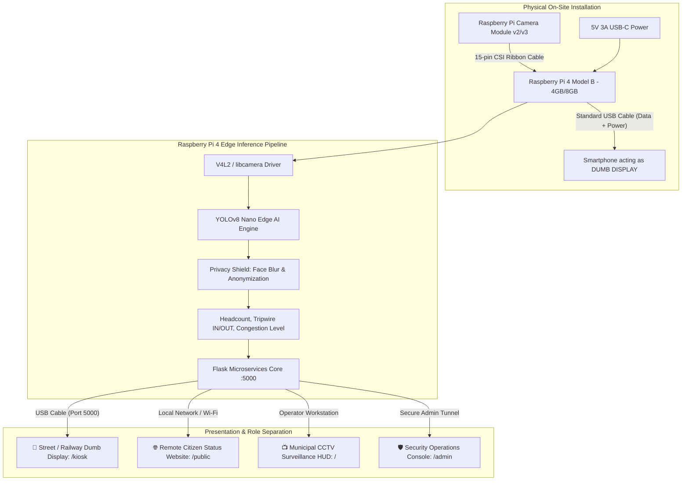

# 🛠️ Hardware Deployment & Privacy Ethics Architecture Guide
## AI Tourist Crowd Monitor (Raspberry Pi 4 + Pi Cam + Phone Dumb Display)

This document provides the complete hardware wiring, setup commands, and architectural privacy framework for the **AI Tourist Crowd Monitor**, specifically tailored for the **Round 1 (20% milestone)** evaluation of the 3-round competition.

---

## 1. System Hardware Architecture



---

## 2. Hardware Bill of Materials (BOM)

| Component | Specification | Role in System |
| :--- | :--- | :--- |
| **Computing Core** | **Raspberry Pi 4 Model B** (4GB or 8GB LPDDR4) | Runs local YOLOv8 inference, Flask backend, and telemetry without cloud reliance. |
| **Vision Sensor** | **Raspberry Pi Camera Module** (v2, v3, or HQ Cam) | Captures pedestrian flow via high-speed 15-pin CSI ribbon cable. |
| **Public Display** | **Android Smartphone** (Any 5" to 6.7" smartphone) | **Acts 100% as a DUMB DISPLAY via USB cable.** Runs zero phone apps, suppressed OS controls. |
| **Interconnect** | **USB-A to USB-C / Micro-USB cable** | Connects Raspberry Pi 4 USB port to Phone for reverse networking, display output, and trickle power. |
| **Power Supply** | Official 5V 3.0A USB-C Power Adapter | Powers the Raspberry Pi 4 and simultaneously powers the connected phone. |
| **Cooling & Enclosure**| Aluminum heatsink case + 5V miniature fan | Keeps Raspberry Pi 4 CPU temperature stable (~42°C - 48°C) during continuous YOLO inference. |

---

## 3. Public vs. Admin Privacy Ethics Separation

A critical requirement for municipal deployments and hackathon evaluation is **Privacy Ethics**. Raw surveillance video must never be exposed indiscriminately.

### 🛡️ Layer 1: Street & Railway Public External Display (`/kiosk`)
*Mounted publicly on street corners, platform concourses, or visitor entry checkpoints.*
- **What is NOT Visible (Ethics Compliance)**:
  - ❌ **NO live camera video feed of people walking.** Citizens must not see surveillance video of themselves walking on the street.
  - ❌ **NO bounding boxes tracking individuals.**
  - ❌ **NO admin controls, settings, URLs, or debug logs.**
- **What IS Visible (Railway PIDS Signage Mode)**:
  - ✅ **Traffic-Light Congestion Status**:
    - 🟢 **GREEN**: Normal Flow (< 60% Capacity)
    - 🟡 **AMBER**: Moderate Crowd / High Footfall (60% - 85% Capacity)
    - 🔴 **RED**: Overcrowded / Regulated Entry (> 85% Capacity)
  - ✅ **Live Occupancy Ratio**: e.g., `1,679 / 2,000 Visitors` (Large, high-contrast readable from 20 meters).
  - ✅ **Continuous In/Out Footfall Flow**: Total entries and exits.
  - ✅ **Daily Peak Update**: `⚠️ Crowd rises near 9:30 pm`.
  - ✅ **Live Municipal Advisory Marquee**: Scrolling broadcast updated dynamically by the Admin.
  - ✅ **GDPR & DPDP Privacy Declaration**: Informs citizens that counting is 100% anonymous and edge-computed.

---

### 🌐 Layer 2: Remote Citizen & Tourist Website (`/public`)
*Visited by tourists and citizens sitting far away (at home, hotel, or in transit) wanting to plan their visit.*
- **Privacy Ethics**:
  - ❌ **Zero video streaming**: Prevents remote voyeurism or stalking of individuals in public places.
  - ✅ **Real-Time Crowd Level & Congestion Percentage**.
  - ✅ **Estimated Gate Queue Wait Times** (~2 - 4 minutes).
  - ✅ **Best Visiting Hours Guide** (Quiet hours: 10:00 AM – 4:30 PM).
  - ✅ **36-Hour Crowd Forecast & Historical Footfall Trends**.
  - ✅ **Official Municipal Safety Announcements**.

---

### 📺 Layer 3: Municipal CCTV Surveillance Screen (`/`)
*Exact municipal command display matching your reference image.*
- **Features**:
  - Fullscreen CCTV feed with pastel bounding boxes (`HUMAN`, `Bicycle`, `Bag`).
  - **Automated Privacy Shield**: Built-in Gaussian Face Blur so even municipal staff cannot collect facial biometrics without high-level clearance.
  - Top-Right Yellow Telemetry HUD (`Current Entries: 456`, `No. of Exits: 9879`, `1679/2000`, `Accuracy: 87%`, `Daily Update: 08:56 pm`).
  - Bottom Running Ticker Marquee with `● LIVE` badge.

---

### 🛡️ Layer 4: Security Operations Admin Console (`/admin`)
*Private, authenticated operator portal.*
- **Full Rights & Administrative Controls**:
  - Live operator stream monitor with toggleable overlays (Raw Feed, Face Blur, Centroids, Heatmap, Tripwire).
  - Live Ticker Broadcast Controller: Instantly changes running marquee text on all public displays.
  - Daily Peak Advisory & Accuracy Editor.
  - Venue Capacity and Warning/Critical Alert Threshold adjusters.
  - Video Input Switcher: Switch live between Pi Cam CSI (`/dev/video0`), USB Webcam, or RTSP Stream.
  - Raspberry Pi 4 Hardware Health Monitor: Real-time CPU Temperature, RAM usage, and YOLO FPS.
  - Reset In/Out Footfall Counters.
  - **1-Click Download of 36-Hour Ground Truth Evidence CSV** for judges and auditors.

---

## 4. Step-by-Step Hardware Setup Instructions

### Step 1: Connect Raspberry Pi Camera Module
1. Locate the **CAM** port on the Raspberry Pi 4 (between HDMI ports and 3.5mm audio jack).
2. Gently pull up the plastic locking collar.
3. Insert the 15-pin CSI ribbon cable with the **silver contacts facing the HDMI ports** (blue tape facing audio jack).
4. Press the collar down firmly to lock the ribbon in place.
5. Enable camera in Raspberry Pi OS:
   ```bash
   sudo raspi-config
   # Navigate to: Interface Options -> Legacy Camera / Camera -> Enable -> Reboot
   ```
6. Test camera capture:
   ```bash
   # Test video device
   ls -l /dev/video*
   # Or capture a test frame
   libcamera-jpeg -o test.jpg
   ```

---

### Step 2: Connect Phone as a DUMB DISPLAY via USB
The phone runs **NO custom apps** and **NO phone functions**. It acts purely as an external monitor:

1. Connect the smartphone to any USB port on the Raspberry Pi 4 using a standard USB cable.
2. On the smartphone:
   - Go to **Settings -> About Phone -> Tap 'Build Number' 7 times** to unlock Developer Options.
   - Go to **Developer Options -> Enable 'USB Debugging'**.
   - When the prompt appears: *"Allow USB debugging from this computer?"* -> Check **"Always allow"** and tap **OK**.
3. On the Raspberry Pi 4, execute the automated setup script:
   ```bash
   chmod +x setup_phone_display.sh
   ./setup_phone_display.sh
   ```
4. **What the script does automatically**:
   - Puts phone into **Stay Awake** mode while USB is connected.
   - Locks orientation to **Landscape (Horizontal)**.
   - Sets brightness to maximum for high outdoor visibility.
   - Maps Raspberry Pi port 5000 to the phone via USB reverse port forwarding (`adb reverse tcp:5000 tcp:5000`).
   - Launches `http://localhost:5000/kiosk` in full-screen immersive mode.
   - Hides Android navigation bar and status bar — phone is now a pure dumb digital signage board!

---

## 5. Round 1 (20% Evaluation) Competition Checklist

In Round 1, evaluators verify foundational feasibility, edge hardware readiness, and core intelligence:

| Evaluation Criteria | How Your Project Delivers It | Verification Method |
| :--- | :--- | :--- |
| **1. Edge Hardware Feasibility** | Entire stack runs on **Raspberry Pi 4 + Pi Cam + Phone via USB** without heavy cloud dependency. | Show `setup_phone_display.sh` and `/api/system/health` reporting Pi 4 CPU & RAM. |
| **2. Real-time Computer Vision** | YOLOv8 person detection, multi-person tracking, and bidirectional tripwire counter (`IN` / `OUT`). | Show live camera detections with counts updating dynamically. |
| **3. Privacy Ethics Separation** | Public Street Display (`/kiosk`) and Citizen Website (`/public`) hide private surveillance video; CCTV HUD (`/`) applies Face Blur. | Open `/kiosk` and `/public` side-by-side with `/admin`. |
| **4. 36-Hour Ground Truth Evidence** | Built-in statistical verification module calculating MAE, RMSE, Accuracy %, and Alert F1 Score. | Click **"Download 36-Hour Evidence CSV"** inside `/admin` to hand to judges. |
| **5. Live Operational Control** | Admin panel can dynamically update announcements, surge warnings, and capacity thresholds in real time. | Type a notice in `/admin` and watch it appear instantly on the phone screen! |
